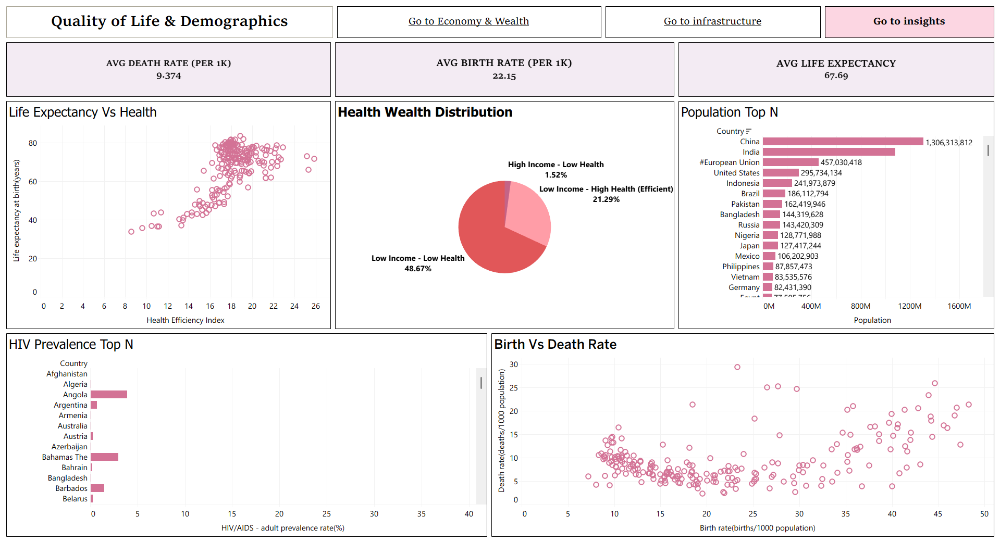
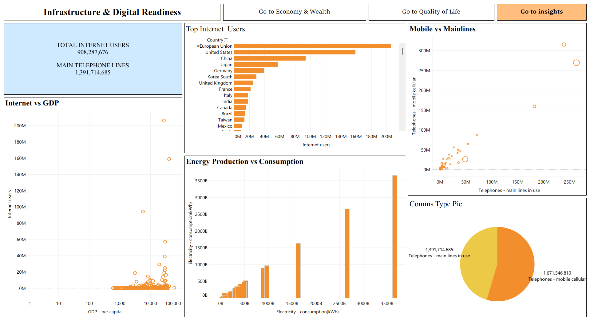

# 🌐 Global Economic, Demographic & Infrastructure Analytics Suite
## 📌 Project Overview
An end-to-end executive analytical portfolio designed in Tableau to evaluate global development metrics across **200+ countries and territories**. The project transforms multi-domain macro-data into an interactive 3-tier dashboard suite equipped with strategic executive insights, dynamic top-N parameters, global cross-filtering, and seamless navigation.
---

## 🛠️ Technical Architecture & Key Features

### 1. **Data Engineering & Preparation**
* **Data Cleansing & Standardisation:** Processed real-world macro-data covering economic indicators, population demographics, health statistics, and infrastructure readiness.
* **Type Conversion & Measure Formatting:** Standardised string-encoded numeric fields (e.g., telephone lines, internet statistics) into continuous aggregatables (`SUM`, `AVG`) to enable precise spatial and statistical calculations.
* **Calculated Fields & Dynamic Metrics:** Built parameters (e.g., `p_Top_N`, dynamic metrics selection) and dynamic fields to allow drill-down analysis without cluttering dashboard interfaces.
-
### 2. **Dashboard Suite Structure**

#### 🟢 **Dashboard 1: Economy & Wealth**
* **Core Focus:** Global wealth distribution, trade dynamics, and macroeconomic stability.
* **Key Visualisations:**
* **Global Map & Top-N GDP Bar Chart:** Ranks global economies dynamically based on nominal GDP.
* **Inflation vs. Growth Scatter Plot:** Identifies macro-economic outliers by comparing real growth rates against consumer price inflation.
* **Trade Balance Bar Chart:** Evaluates export/import equilibrium and surplus/deficit metrics across leading industrial economies.
* **Executive KPI Cards:** High-level metrics tracking total global GDP, average per capita income, and total external debt obligations.

#### 🟣 **Dashboard 2: Quality of Life & Demographics**
* **Core Focus:** Health efficiency, demographic shifts, and global disease prevalence.
* **Key Visualisations:**
* **Health-Wealth Distribution (Quadrant Pie Chart):** Categorises nations into 4 performance quadrants, highlighting high health efficiency in low/middle-income countries.
* **Life Expectancy vs. Health Efficiency Scatter Plot:** Evaluates the direct impact of healthcare expenditure on population longevity.
* **Demographic Trends (Birth vs. Death Rate Plot):** Maps natural population change against economic maturity.
* **Top-N HIV Prevalence & Population Charts:** Highlights critical demographic hotspots and public health challenges.

#### 🟠 **Dashboard 3: Infrastructure & Digital Readiness**
* **Core Focus:** Telecommunications infrastructure, internet penetration, and energy capacity.
* **Key Visualisations:**
* **Comms Type Breakdown (Pie Chart):** Compares mobile cellular adoption versus fixed mainline infrastructure.
* **Internet Penetration vs. GDP per Capita Logarithmic Scatter:** Demonstrates the exponential relationship between national wealth and digital adoption.
* **Energy Production vs. Consumption Dual Bar:** Evaluates national grid capacity as a fundamental constraint for digital infrastructure expansion.
* **Infrastructure KPI Cards:** Tracks total global internet users and mainline connectivity.
---

### 3. **Interactivity & UX Strategy**
* **Native Navigation Integration:** Embedded custom button objects (`Navigation`) allowing fluid transition between dashboards and dedicated executive insight pages without breaking context.
* **Global Slicers & Context Filters:** Implemented `Apply to Worksheets` filter logic across parameters and country dimensions for unified cross-dashboard filtering.
* **Cross-Highlighting & Actions:** Enabled dynamic highlight actions on maps and categorical elements for instant context matching across all visible charts.
---

## 📊 Summary of Strategic Insights
* **Macroeconomic Concentration:** Global wealth and trade surpluses remain tightly clustered within a small subset of major industrial powers, while developing nations face disproportionately high debt-to-GDP ratios.
* **Healthcare Efficiency Gap:** Approximately **21.29%** of nations achieve high life expectancy despite lower income levels (`Low Income - High Health`), proving that operational efficiency and allocation matter as much as total capital expenditure.
* **Mobile-First Infrastructure Leap:** Mobile cellular subscriptions (**1.67 Billion**) vastly outweigh legacy mainlines (**1.39 Billion**), illustrating how emerging markets bypassed capital-intensive wired infrastructure to accelerate digital readiness.

---
## 💻 Tech Stack & Tools

* **BI Tool:** Tableau Desktop / Tableau Public
* **Data Manipulation:** Data Type Conversions, Custom Aggregations, Grouping & Quadrant Categorisation
* **Design & UX:** Custom Palette Coding, Native Object Layouts, Text Sheet Executive Summary Cards
## 📸 Dashboard Preview

### 1. Economy & Wealth
)

### 2. Quality of Life & Demographics

### 3. Infrastructure & Digital Readiness

